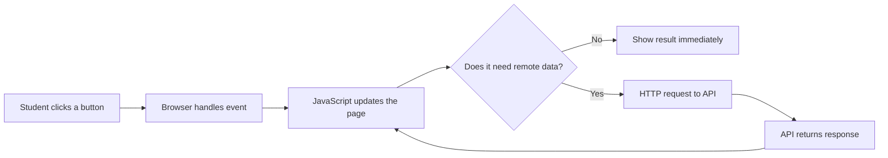
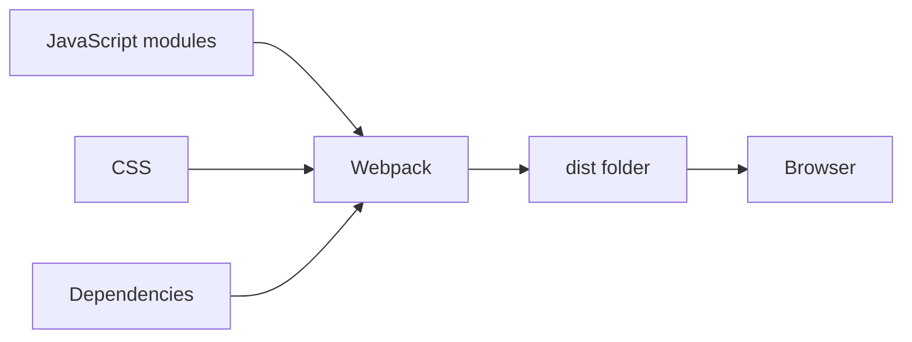

# QHO640 Contemporary Web Applications
## Week 1 Seminar | Modern JavaScript and Packaging

**Duration:** 2 hours | **Level:** Beginner-friendly | **Deliverable:** Three small working web applications

> **What will you achieve?** You will learn how a browser responds to JavaScript, how modern syntax makes code easier to maintain, how application data changes, how asynchronous operations work, and why developers use ES modules and bundlers.

**Tools:** VS Code, a browser, Node.js LTS and npm. Check installation:

```bash
node --version
npm --version
```

If either command fails, install Node.js LTS from [nodejs.org](https://nodejs.org/), then reopen your terminal. Use a new folder for the exercises:

```bash
mkdir qho640-week1
cd qho640-week1
```

> **Timing:** Recap 15 min · Project 1 25 min · Project 2 35 min · Project 3 35 min · Quiz and GitHub 10 min. The extension challenges are optional homework.

---

# Part A: Interactive recap (15 minutes)

## 1. What happens when you use a web app?




**Real-world example:** At a supermarket self-checkout, the interface displays scanned items, JavaScript updates the total, and a remote service might verify payment. **Frontend** is what the shopper sees; **backend** processes requests and accesses stored information.

<details><summary><strong>Quick question: Does every button click need a backend?</strong></summary>

No. Updating a counter or calculating a total can happen entirely in the browser. Saving an order across devices typically requires persistent storage or a backend service.
</details>

## 2. Modern JavaScript in one minute

| Concept | Simple explanation | Everyday example |
|---|---|---|
| `const` / `let` | Declare values; `let` can be reassigned | A fixed VAT rate vs a changing basket total |
| Arrow functions | Concise function syntax | A checkout rule applied to each item |
| Destructuring | Pick properties from an object | Read just a student's name and course |
| Template literals | Insert values into text with `${...}` | “Hello Sam, your total is £12” |
| Optional chaining `?.` | Access possibly missing data safely | A student profile may have no phone number |
| `map()` | Transform every array item | Apply a discount to every price |
| `filter()` | Keep matching array items | Show only unfinished tasks |
| DOM + events | React to user actions and change the page | Clicking Add updates a task list |
| `async` / `await` | Wait for asynchronous results clearly | Wait for course information to load |
| `import` / `export` | Share code across files | Reuse a calculator in several pages |
| Webpack | Process modules into browser-ready output | Package a project for delivery |

<details><summary><strong>Try to predict the output</strong></summary>

```js
const student = { name: 'Sam', profile: null };
const { name } = student;
console.log(`${name}: ${student.profile?.city ?? 'Not provided'}`);
```

**Answer:** `Sam: Not provided`. Destructuring extracts `name`; optional chaining prevents an error when `profile` is `null`; `??` supplies a fallback.
</details>

## 3. Why use a bundler?



**Analogy:** npm obtains the ingredients (packages); Webpack prepares the package for delivery. Webpack can bundle modules, process assets, split code and produce optimised builds. A bundler is **not** a database or an authentication system.

---

# Part B: Project 1: Smart Checkout Calculator (25 minutes)

**Goal:** Build a working checkout screen. **Concepts:** `const`, arrow functions, destructuring, template literals, `Number()`, DOM events and validation.

## Step 1: Create the files

```bash
mkdir project-1-checkout
cd project-1-checkout
touch index.html style.css app.js
```

Windows PowerShell: create the three files using VS Code's Explorer if `touch` is unavailable.

## Step 2: Paste into `index.html`

```html
<!DOCTYPE html>
<html lang="en">
<head>
  <meta charset="UTF-8" />
  <meta name="viewport" content="width=device-width, initial-scale=1" />
  <title>Smart Checkout</title>
  <link rel="stylesheet" href="style.css" />
  <script src="app.js" defer></script>
</head>
<body>
  <main class="panel">
    <h1>Smart Checkout</h1>
    <label for="item">Product</label>
    <select id="item">
      <option value="notebook">Notebook</option>
      <option value="headphones">Headphones</option>
      <option value="mouse">Mouse</option>
    </select>
    <label for="quantity">Quantity</label>
    <input id="quantity" type="number" min="1" value="1" />
    <button id="calculate">Calculate total</button>
    <p id="result" role="status">Choose a product and calculate.</p>
  </main>
</body>
</html>
```

## Step 3: Paste into `style.css`

```css
* { box-sizing: border-box; }
body { margin: 0; background: #f1f5f9; color: #172033;
       font: 17px/1.5 system-ui, sans-serif; }
.panel { max-width: 480px; margin: 60px auto; padding: 28px;
         background: white; border: 1px solid #cbd5e1; border-radius: 16px; }
label { display: block; margin: 14px 0 6px; font-weight: 700; }
select, input, button { width: 100%; padding: 12px; font: inherit; }
button { margin-top: 20px; background: #155eaa; color: white;
         border: 0; border-radius: 8px; cursor: pointer; }
#result { padding: 14px; background: #e8f3ff; border-radius: 8px; }
```

## Step 4: Paste into `app.js`

```js
const products = {
  notebook: { name: 'Notebook', price: 8 },
  headphones: { name: 'Headphones', price: 35 },
  mouse: { name: 'Mouse', price: 18 }
};

const calculateTotal = (price, quantity) => price * quantity;

const itemInput = document.querySelector('#item');
const quantityInput = document.querySelector('#quantity');
const result = document.querySelector('#result');

document.querySelector('#calculate').addEventListener('click', () => {
  const product = products[itemInput.value];
  const { name, price } = product; // Destructuring
  const quantity = Number(quantityInput.value);

  if (!Number.isInteger(quantity) || quantity < 1) {
    result.textContent = 'Enter a whole number of at least 1.';
    return;
  }

  const total = calculateTotal(price, quantity);
  result.textContent = `${quantity} × ${name} = £${total.toFixed(2)}`;
});
```

## Step 5: Run and test

Open `index.html` in a browser (or use VS Code Live Server if installed). Try **3 notebooks**. Expected result: **`3 × Notebook = £24.00`**. Try quantity `0`: the application should display a validation message.

<details><summary><strong>Explain the code</strong></summary>

- `products` is an object holding product information.
- `const { name, price } = product` extracts two properties.
- `calculateTotal` is an arrow function.
- `addEventListener` runs code when the button is clicked.
- The template literal inserts values into the result string.
- `textContent` safely updates visible text.
</details>

**Challenge:** Add a `keyboard` product priced at £45. Then add a 10% discount for quantities of 5 or more. Test that 5 notebooks cost £36 after the discount.

---

# Part C: Project 2: Student Task Manager (35 minutes)

**Goal:** Build an interactive To-do List. **Concepts:** arrays, objects, `map()`, `filter()`, DOM events, ES6 modules and Local Storage.

## Step 1: Create the files

From the `qho640-week1` root directory:

```bash
mkdir project-2-tasks
cd project-2-tasks
touch index.html style.css main.js tasks.js
```

## Step 2: `index.html`

```html
<!DOCTYPE html>
<html lang="en">
<head>
  <meta charset="UTF-8" />
  <meta name="viewport" content="width=device-width, initial-scale=1" />
  <title>Student Task Manager</title>
  <link rel="stylesheet" href="style.css" />
  <script type="module" src="main.js"></script>
</head>
<body>
  <main class="panel">
    <h1>Student Task Manager</h1>
    <form id="task-form">
      <label for="task">New task</label>
      <input id="task" required placeholder="Complete Week 1 lab" />
      <button>Add task</button>
    </form>
    <p id="count" role="status"></p>
    <div>
      <button id="all" type="button">All</button>
      <button id="active" type="button">Active</button>
      <button id="completed" type="button">Completed</button>
    </div>
    <ul id="task-list"></ul>
  </main>
</body>
</html>
```

## Step 3: `style.css`

```css
* { box-sizing: border-box; }
body { margin: 0; background: #f1f5f9; font: 17px/1.5 system-ui; }
.panel { max-width: 650px; margin: 40px auto; padding: 25px;
         background: white; border-radius: 16px; }
input { padding: 10px; width: 65%; font: inherit; }
button { padding: 10px 12px; margin: 5px; background: #155eaa;
         color: white; border: 0; border-radius: 7px; cursor: pointer; }
li { display: flex; align-items: center; justify-content: space-between;
     gap: 10px; padding: 9px; border-bottom: 1px solid #ddd; }
.done { text-decoration: line-through; color: #64748b; }
```

## Step 4: `tasks.js` (reusable logic)

```js
export const addTask = (tasks, title) => [
  ...tasks,
  { id: crypto.randomUUID(), title, completed: false }
];

export const toggleTask = (tasks, id) => tasks.map(task =>
  task.id === id ? { ...task, completed: !task.completed } : task
);

export const removeTask = (tasks, id) =>
  tasks.filter(task => task.id !== id);

export const filterTasks = (tasks, mode) =>
  mode === 'active' ? tasks.filter(task => !task.completed)
  : mode === 'completed' ? tasks.filter(task => task.completed)
  : tasks;
```

## Step 5: `main.js` (browser interaction)

```js
import { addTask, toggleTask, removeTask, filterTasks } from './tasks.js';

const STORAGE_KEY = 'qho640-week1-tasks';
const form = document.querySelector('#task-form');
const input = document.querySelector('#task');
const list = document.querySelector('#task-list');
const count = document.querySelector('#count');

let tasks;
try {
  const saved = JSON.parse(localStorage.getItem(STORAGE_KEY) ?? '[]');
  tasks = Array.isArray(saved) ? saved : [];
} catch {
  tasks = [];
}
let mode = 'all';

function saveAndRender() {
  localStorage.setItem(STORAGE_KEY, JSON.stringify(tasks));
  render();
}

function render() {
  list.replaceChildren();
  const visible = filterTasks(tasks, mode);
  count.textContent = `${tasks.filter(t => !t.completed).length} tasks remaining`;

  visible.forEach(task => {
    const li = document.createElement('li');
    const label = document.createElement('span');
    label.textContent = task.title;
    if (task.completed) label.classList.add('done');

    const toggle = document.createElement('button');
    toggle.textContent = task.completed ? 'Undo' : 'Done';
    toggle.addEventListener('click', () => {
      tasks = toggleTask(tasks, task.id);
      saveAndRender();
    });

    const remove = document.createElement('button');
    remove.textContent = 'Delete';
    remove.addEventListener('click', () => {
      tasks = removeTask(tasks, task.id);
      saveAndRender();
    });

    li.append(label, toggle, remove);
    list.append(li);
  });
}

form.addEventListener('submit', event => {
  event.preventDefault();
  const title = input.value.trim();
  if (!title) return;
  tasks = addTask(tasks, title);
  input.value = '';
  saveAndRender();
});

for (const filter of ['all', 'active', 'completed']) {
  document.getElementById(filter).addEventListener('click', () => {
    mode = filter;
    render();
  });
}
render();
```

## Step 6: Run and test

**Important:** ES modules should be served over HTTP, not opened using `file://`. From the `project-2-tasks` folder, run:

```bash
npx --yes http-server . -p 8080 -c-1
```

Open `http://localhost:8080`. Add three tasks, complete one, click **Active**, then refresh the page. The completed task should remain saved and appear under **Completed**. Stop the server with `Ctrl+C`.

<details><summary><strong>Why are we using separate files?</strong></summary>

`tasks.js` handles data transformations. `main.js` handles browser events and rendering. This separation makes the application easier to test and maintain. `map()` produces an updated task array, `filter()` removes or selects tasks, and `localStorage` persists data **in this browser**, not on a server.
</details>

**Challenge:** Add a **Clear completed** button. Hint: `tasks = tasks.filter(task => !task.completed); saveAndRender();`.

---

# Part D: Project 3: Course Explorer with Webpack (35 minutes)

**Goal:** Fetch simulated course data asynchronously and package the app with Webpack. **Concepts:** `Promise`, `async/await`, error handling, ES modules, npm and bundling.

## Step 1: Create the project

From the `qho640-week1` root directory:

```bash
mkdir project-3-courses
cd project-3-courses
npm init -y
npm install --save-dev webpack webpack-cli
mkdir src
```

Create these files in VS Code:

```text
project-3-courses/
├── index.html
├── package.json
├── webpack.config.cjs
└── src/
    ├── index.js
    ├── courses.js
    └── style.css
```

## Step 2: `index.html`

```html
<!DOCTYPE html>
<html lang="en">
<head>
  <meta charset="UTF-8" />
  <meta name="viewport" content="width=device-width, initial-scale=1" />
  <title>Course Explorer</title>
  <link rel="stylesheet" href="src/style.css" />
  <script src="dist/bundle.js" defer></script>
</head>
<body>
  <main class="panel">
    <h1>Course Explorer</h1>
    <button id="load">Load courses</button>
    <p id="status" role="status">Ready.</p>
    <ul id="courses"></ul>
  </main>
</body>
</html>
```

## Step 3: `src/style.css`

```css
body { background: #f1f5f9; color: #172033; font: 17px/1.5 system-ui; }
.panel { max-width: 600px; margin: 45px auto; padding: 26px;
         background: white; border-radius: 15px; }
button { background: #155eaa; color: white; padding: 12px;
         border: 0; border-radius: 8px; cursor: pointer; }
li { padding: 9px; border-bottom: 1px solid #ddd; }
```

## Step 4: `src/courses.js`

```js
const COURSES = [
  { id: 1, title: 'Modern JavaScript', level: 'Beginner' },
  { id: 2, title: 'React Fundamentals', level: 'Intermediate' },
  { id: 3, title: 'Web Security Basics', level: 'Beginner' }
];

export async function fetchCourses() {
  // Simulates a remote API request without requiring internet or credentials.
  await new Promise(resolve => setTimeout(resolve, 1000));
  return COURSES;
}
```

## Step 5: `src/index.js`

```js
import { fetchCourses } from './courses.js';

const button = document.querySelector('#load');
const status = document.querySelector('#status');
const list = document.querySelector('#courses');

button.addEventListener('click', async () => {
  button.disabled = true;
  status.textContent = 'Loading courses...';
  list.replaceChildren();

  try {
    const courses = await fetchCourses();
    courses.forEach(({ title, level }) => {
      const item = document.createElement('li');
      item.textContent = `${title} (${level})`;
      list.append(item);
    });
    status.textContent = `Loaded ${courses.length} courses.`;
  } catch (error) {
    console.error(error);
    status.textContent = 'Could not load courses. Please retry.';
  } finally {
    button.disabled = false;
  }
});
```

## Step 6: `webpack.config.cjs`

```js
const path = require('path');

module.exports = {
  mode: 'development',
  entry: './src/index.js',
  output: {
    filename: 'bundle.js',
    path: path.resolve(__dirname, 'dist'),
    clean: true
  },
  devtool: 'source-map'
};
```

## Step 7: Build and run

```bash
npx webpack
npx --yes http-server . -p 8081 -c-1
```

Open `http://localhost:8081`. Click **Load courses**. You should see a loading message for approximately one second, followed by three courses. Stop the server with `Ctrl+C`.

Inspect the `dist/` folder. **Webpack has generated `bundle.js` from your ES module source files.** You can open `dist/bundle.js` to see the generated output. `bundle.js.map` is a source map used for debugging.

<details><summary><strong>What is asynchronous about this example?</strong></summary>

`fetchCourses()` returns a Promise. `await` waits for it to settle within the async function. The browser can still respond to other events while waiting. `try/catch/finally` provides error handling and resets the button. This lab uses a **simulated API**, not a real HTTP request.
</details>

**Challenge:** Add a fourth course. Then temporarily insert `throw new Error('Service unavailable');` inside `fetchCourses()` before the `return`. Rebuild using `npx webpack` and check that the error message appears. Remove the error and rebuild.

---

# Part E: Knowledge check and discussion (5 minutes)

<details><summary>1. What is the difference between `map()` and `filter()`?</summary>

`map()` transforms each item and returns a new array. `filter()` returns a new array containing only items that meet a condition.
</details>

<details><summary>2. Why do we use `event.preventDefault()` in the task form?</summary>

It prevents the browser's default form submission and page navigation, allowing JavaScript to handle the task locally.
</details>

<details><summary>3. What does `await` do?</summary>

It waits for a Promise to settle inside an async function. It does not freeze the whole browser.
</details>

<details><summary>4. Is Local Storage a cloud database?</summary>

No. It stores data locally in the browser for that origin. Other devices do not automatically share it.
</details>

<details><summary>5. Why did Project 3 need Webpack?</summary>

To practise processing imported JavaScript modules into a browser-ready bundle. Native browser modules also exist, as demonstrated in Project 2.
</details>

<details><summary>6. What does optional chaining prevent?</summary>

It avoids an exception when trying to access a property through `null` or `undefined` (for example, `student.profile?.city`).
</details>

# Part F: Save your work to GitHub (5 minutes)

Return to the `qho640-week1` root directory. Create a `.gitignore` file with:

```gitignore
node_modules/
dist/
.env
.env.local
.DS_Store
```

Then run:

```bash
git init
git add .
git commit -m "Complete QHO640 Week 1 JavaScript mini projects"
```

Create an empty repository in GitHub, then follow GitHub's instructions to add the remote and push. **Do not commit `node_modules/` or secret files.** For Project 3, anyone cloning your repository can run `npm install` followed by `npx webpack` to regenerate `dist/`.

## Final checklist

- [ ] I can explain the browser → JavaScript → API → database architecture.
- [ ] Project 1 calculates a total and validates quantities.
- [ ] Project 2 adds, completes, deletes, filters and saves tasks.
- [ ] Project 3 loads course data asynchronously and handles errors.
- [ ] I can explain `import`, `export`, npm and Webpack.
- [ ] I have committed my work to Git.

**Next step:** These JavaScript concepts prepare you to build reusable interfaces and manage state with React in subsequent sessions.

---

### Further reading

- [MDN JavaScript Guide](https://developer.mozilla.org/en-US/docs/Web/JavaScript/Guide)
- [MDN JavaScript Modules](https://developer.mozilla.org/en-US/docs/Web/JavaScript/Guide/Modules)
- [MDN Using Promises](https://developer.mozilla.org/en-US/docs/Web/JavaScript/Guide/Using_promises)
- [Webpack Concepts](https://webpack.js.org/concepts/)
- [npm Documentation](https://docs.npmjs.com/)
